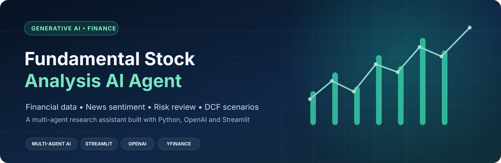
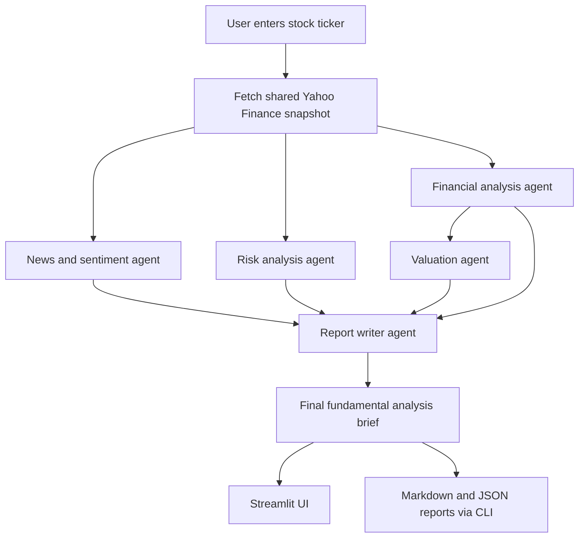
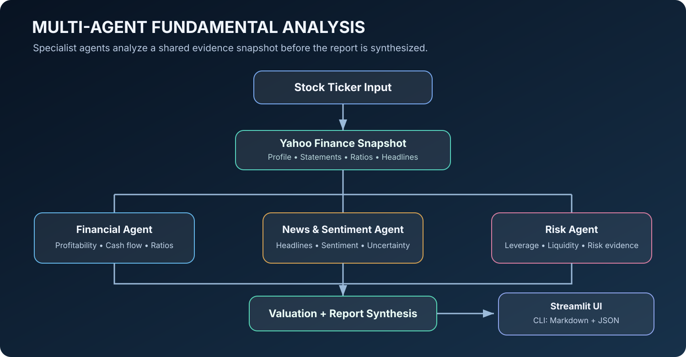

# Fundamental Stock Analysis AI Agent

<p align="center">
  
</p>

<p align="center">
  <a href="#what-it-does">Features</a> ·
  <a href="#how-the-analysis-works">Architecture</a> ·
  <a href="#getting-started">Quick Start</a> ·
  <a href="#run-with-docker">Docker</a>
</p>

[](https://www.python.org/)
[](https://streamlit.io/)
[](https://platform.openai.com/)
[](https://finance.yahoo.com/)
[](https://www.docker.com/)


An AI-assisted stock research application that brings together company financials, recent news headlines, risk commentary, peer-multiple context, and an illustrative discounted cash flow (DCF) scenario into one readable research brief.

The project is built in Python with a Streamlit interface, Yahoo Finance data retrieval through `yfinance`, and OpenAI-powered specialist agents. It also supports command-line report generation and containerized execution with Docker.

> **Important:** This project is an educational research tool, not investment advice. Market and company data may be delayed, incomplete, or unavailable. Valuation outputs depend on assumptions and should not be treated as forecasts or price targets.

---

## Table of contents

- [What it does](#what-it-does)
- [How the analysis works](#how-the-analysis-works)
- [Architecture](#architecture)
- [Technology stack](#technology-stack)
- [Repository structure](#repository-structure)
- [Prerequisites](#prerequisites)
- [Getting started](#getting-started)
- [Run the Streamlit application](#run-the-streamlit-application)
- [Run from the command line](#run-from-the-command-line)
- [Run with Docker](#run-with-docker)
- [Configuration](#configuration)
- [Reports and outputs](#reports-and-outputs)
- [Data quality and responsible use](#data-quality-and-responsible-use)
- [Troubleshooting](#troubleshooting)
- [Possible next enhancements](#possible-next-enhancements)
- [License](#license)

## What it does

For a supplied stock ticker, the application collects an available company snapshot and coordinates a set of focused analysis agents.

| Area | Current implementation |
|---|---|
| Company and financial data | Retrieves selected company information, financial statements, valuation/quality ratios, and recent headlines through Yahoo Finance using `yfinance`. |
| Financial analysis | Uses an LLM agent to summarize revenue, profitability, cash flow, margins, return on equity, and available ratios. |
| News and sentiment | Reviews available recent news headlines and produces a sentiment summary with uncertainty called out. |
| Risk review | Examines available leverage, liquidity, cash-flow, beta, and headline evidence. |
| Valuation | Calculates an illustrative DCF scenario when the required inputs are available and retrieves a sector-based candidate peer set for context. |
| Final research brief | Combines specialist outputs into a Markdown-style summary with a rating category, supporting evidence, risks, limitations, and bull/base/bear considerations. |
| User interface | Provides a Streamlit screen to enter a ticker and inspect the final, financial, news, risk, and valuation sections. |
| Export | The command-line workflow saves Markdown and JSON report files under `reports/`. |

The analysis is evidence-oriented: prompts instruct the model not to invent missing facts. When a required fact cannot be established from the supplied data, the expected wording is:

```text
Cannot be confirmed from available information.
```

## How the analysis works

At a high level, the workflow is:

1. **Ticker input** — The user supplies a stock symbol.
2. **Snapshot retrieval** — A shared data tool collects the available company profile, selected financial statements, key ratios, and recent headlines. A short-lived in-memory cache helps reuse the same snapshot.
3. **Parallel specialist analysis** — Financial, news/sentiment, and risk agents analyze the shared snapshot.
4. **Valuation** — The valuation agent runs the DCF scenario when its inputs are usable and retrieves candidate peer multiples.
5. **Report synthesis** — The report writer combines the specialist results into a single research brief.
6. **Presentation or export** — Streamlit displays the sections; the CLI saves Markdown and JSON outputs.



## Architecture

### Agent workflow

<p align="center">
  
</p>


The code is organized around specialist agents and reusable data tools.

### Agents

- **OrchestratorAgent** — Coordinates the workflow, runs financial, news, and risk analysis concurrently, then invokes valuation and report synthesis.
- **FinancialDataAgent** — Summarizes the available statements and financial ratios.
- **NewsAndSentimentAgent** — Classifies sentiment from the retrieved headlines.
- **RiskAgent** — Produces an evidence-based risk assessment. If evidence is insufficient, it should remain unconfirmed rather than speculate.
- **ValuationAgent** — Calls the DCF scenario calculator and peer-multiple retrieval function.
- **ReportWriterAgent** — Synthesizes the specialist outputs into the final report.

### Tools and shared services

- **financial_tools.py** — Retrieves and compacts Yahoo Finance data, calculates/normalizes selected values, and maintains a small in-memory TTL cache.
- **news_tools.py** — Passes snapshot headlines to the news/sentiment analysis.
- **valuation_tools.py** — Contains the illustrative DCF calculation and sector-based peer candidate retrieval.
- **llm_client.py** — Creates a reusable OpenAI client and applies shared evidence-grounding instructions, request timeout, and retry configuration.

## Technology stack

| Component | Technology |
|---|---|
| Language | Python 3.12 |
| User interface | Streamlit |
| LLM | OpenAI API (Responses API) |
| Market/company data | Yahoo Finance via `yfinance` |
| Data handling | Pandas, NumPy |
| Configuration | `python-dotenv` |
| Containerization | Docker |

Dependencies are listed in [requirements.txt](requirements.txt).

## Repository structure

```text
15.Fundamental Stock Analysis AI Project/
├── fundamental_analysis_agent/
│   ├── __init__.py
│   ├── main.py                    # CLI entry point
│   ├── streamlit_app.py           # Streamlit UI
│   ├── llm_client.py              # Shared OpenAI client and grounding rules
│   ├── agents/
│   │   ├── orchestrator.py
│   │   ├── financial_data_agent.py
│   │   ├── news_sentiment_agent.py
│   │   ├── risk_agent.py
│   │   ├── valuation_agent.py
│   │   └── report_writer_agent.py
│   └── tools/
│       ├── financial_tools.py
│       ├── news_tools.py
│       └── valuation_tools.py
├── reports/                       # Generated CLI reports
├── requirements.txt
├── Dockerfile
├── run-docker.ps1
├── .dockerignore
└── .gitignore
```

## Prerequisites

- Python **3.12**
- An OpenAI API key with access to a model configured for the project
- Internet access for the data provider and OpenAI API
- Docker Desktop (optional, for container execution)

## Getting started

The commands below are for Windows PowerShell, from this project directory.

### 1. Clone the repository

```powershell
git clone https://github.com/gangadharp2010/AIPROJECT.git
cd "AIPROJECT/15.Fundamental Stock Analysis AI Project"
```

### 2. Create and activate a virtual environment

```powershell
py -3.12 -m venv .venv
.\.venv\Scripts\Activate.ps1
```

If PowerShell blocks activation for the current session, run:

```powershell
Set-ExecutionPolicy -Scope Process -ExecutionPolicy Bypass
.\.venv\Scripts\Activate.ps1
```

### 3. Install dependencies

```powershell
python -m pip install --upgrade pip
pip install -r requirements.txt
```

### 4. Configure environment variables

Create a `.env` file in the project root. Add your own key; do not commit this file.

```dotenv
OPENAI_API_KEY=your_openai_api_key
OPENAI_MODEL=gpt-4.1-mini
OPENAI_TIMEOUT_SECONDS=45
OPENAI_MAX_RETRIES=2
DATA_CACHE_TTL_SECONDS=300
```

The code defaults to `gpt-4.1-mini` when `OPENAI_MODEL` is not set. The timeout, retry count, and cache TTL are optional settings.

> Never paste API keys into source code, screenshots, logs, or public issues. Keep `.env` out of version control.

## Run the Streamlit application

From the project root, with the virtual environment activated:

```powershell
python -m streamlit run fundamental_analysis_agent/streamlit_app.py
```

Open the local URL printed by Streamlit (normally [http://localhost:8501](http://localhost:8501)).

Enter a ticker symbol (for example, `AAPL`) and select **Analyze**. The page presents the final report and the specialist analysis sections.

## Run from the command line

Run the package module from the project root:

```powershell
python -m fundamental_analysis_agent.main AAPL
```

Replace `AAPL` with the ticker you want to analyze. The command validates the ticker format, runs the orchestrator, prints the final brief, and saves two files under `reports/`.

Examples of ticker formats depend on the data provider. Confirm the provider's accepted symbol format for the exchange you are researching.

## Run with Docker

Make sure Docker Desktop is running and that the project-root `.env` file exists.

### Option A: use the PowerShell helper

```powershell
.\run-docker.ps1
```

The script builds the image, removes an existing container with the same name, and starts the Streamlit application on port `8501`.

### Option B: build and run manually

```powershell
docker build -t fundamental-analysis-agent:latest .
docker run --rm --name fundamental-analysis-agent -p 8501:8501 --env-file .env fundamental-analysis-agent:latest
```

Then open [http://localhost:8501](http://localhost:8501).

To stop the application, press `Ctrl+C` in the terminal running the container.

## Configuration

| Variable | Purpose | Default |
|---|---|---|
| `OPENAI_API_KEY` | API credential used by the OpenAI client | Required |
| `OPENAI_MODEL` | Model used for agent analysis and report writing | `gpt-4.1-mini` |
| `OPENAI_TIMEOUT_SECONDS` | Request timeout in seconds | `45` |
| `OPENAI_MAX_RETRIES` | OpenAI SDK retry count | `2` |
| `DATA_CACHE_TTL_SECONDS` | In-memory financial snapshot cache lifetime | `300` |

## Reports and outputs

The command-line runner creates the `reports/` directory when needed and writes:

- `<TICKER>_fundamental_report.md` — human-readable report with generation timestamp.
- `<TICKER>_fundamental_report.json` — structured result containing the specialist outputs and raw data snapshot.

The Streamlit path currently displays the analysis sections in the browser; report-file export is implemented in the CLI path.

## Data quality and responsible use

Please keep the following limitations in mind:

- **Provider limitations:** Yahoo Finance data availability, field definitions, coverage, and update timing can vary by ticker and exchange.
- **Missing values:** Some companies or markets may not expose every statement, ratio, or headline. Missing data should be treated as unknown, not as zero.
- **News coverage:** Sentiment is inferred from a limited set of retrieved headlines, not a complete review of all company news.
- **Peer selection:** The current peer lookup uses predefined sector-based candidate groups. Candidates are not guaranteed to be directly comparable.
- **DCF assumptions:** The current DCF calculator uses illustrative default growth, discount-rate, terminal-growth, and forecast-period assumptions. Its result is a scenario, not a prediction. Review and stress-test the assumptions before drawing conclusions.
- **LLM output:** Language models can make mistakes. Verify material financial figures and conclusions against primary company filings and other reliable sources.

Do not use this project as the sole basis for an investment decision. It does not know your financial situation, risk tolerance, investment horizon, or portfolio.

## Troubleshooting

### `OPENAI_API_KEY is not configured`

- Confirm that `.env` is in the project root (the same directory from which you launch the command).
- Check that the variable is spelled exactly as `OPENAI_API_KEY`.
- Restart the Streamlit process after changing environment variables.

### Module import errors

- Activate the project virtual environment.
- Run commands from the project root, not from inside the `fundamental_analysis_agent` package directory.
- Reinstall dependencies with `pip install -r requirements.txt`.

### Docker cannot find `.env`

Create the project-root `.env` file before running `run-docker.ps1` or the manual Docker command.

### No or incomplete financial data

Try another provider-supported ticker symbol and check whether the company has coverage in Yahoo Finance. Missing values are an expected possibility; the application should not fabricate them.

### OpenAI request failures

Check API key validity, model access, network connectivity, and the configured timeout. Avoid printing secrets while debugging.

## Known integration gaps

The repository contains the specialist modules and valuation utilities, but a few interfaces should be aligned before relying on valuation output end to end:

- The valuation agent currently passes the complete ratios dictionary as the first argument to `run_dcf_model`, while the calculator expects a numeric free-cash-flow value. As written, the calculator will return no DCF scenario for that input.
- The peer-multiple helper reads sector and peer fields from the top level of the fetched snapshot, although the financial snapshot stores company profile values inside `company_info`. This can leave the peer candidate set empty or incomplete.
- The report writer looks for valuation keys named `analysis` and `dcf_scenario`, while the valuation agent currently returns `dcf_valuation` and `peer_multiples`. Consequently, valuation context may not be included in the synthesized final report as intended.

These are implementation items to resolve; the README describes the architecture and utilities present in the repository, not a claim that every valuation path is already fully integrated.

## Possible next enhancements

Potential future improvements (not represented as completed features) include:

- Add primary-source filing ingestion and source-level citations for key financial facts.
- Add explicit DCF sensitivity tables and configurable assumptions in the UI.
- Add peer selection based on business similarity and normalized financial metrics.
- Add downloadable Markdown/JSON reports from Streamlit.
- Add automated tests for data normalization, DCF calculations, and agent orchestration.
- Add structured logging, request tracing, and provider-health diagnostics.

## License

No project-specific license file was identified in this folder. Unless a license is added, the repository's contents should not be assumed to be available for reuse under an open-source license.
