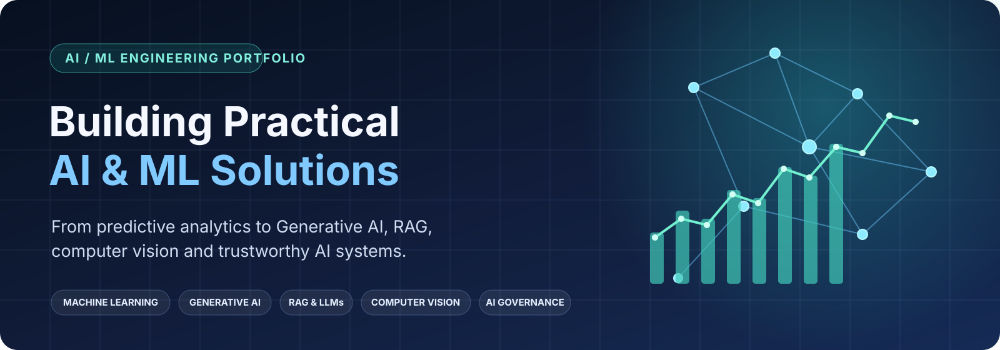
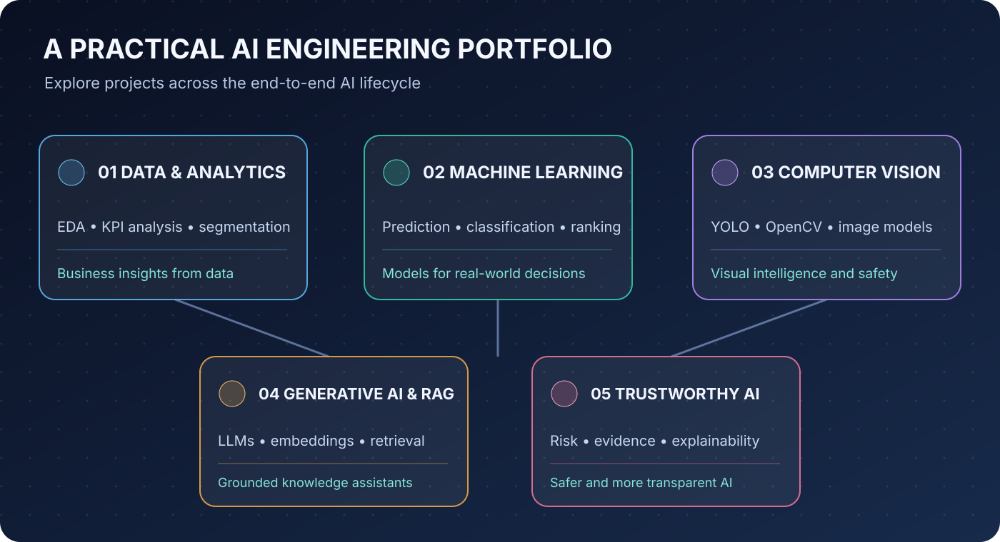

# 🤖 AI / ML Project Portfolio

<p align="center">
  
</p>


> A practical collection of **Machine Learning, Deep Learning, Generative AI, RAG, Computer Vision, Recommendation Systems, and Data Analytics projects** focused on solving real-world business and engineering problems.

[](https://www.python.org/)
[](https://jupyter.org/)
[](https://colab.research.google.com/)
[](https://scikit-learn.org/)
[](https://pytorch.org/)
[](https://huggingface.co/)

---

## 📌 About This Repository

This repository represents my **AI/ML learning and project portfolio**, covering the journey from traditional data analytics and machine learning to modern **Generative AI, Retrieval-Augmented Generation, LLM fine-tuning, Computer Vision, Recommendation Systems, and Responsible AI**.

The projects focus on practical business and technical problems including:

- 📊 Business & customer analytics
- 📈 Predictive modeling
- 🎯 Advertisement click prediction
- 🚕 Ride-hailing analytics
- 🎥 YouTube Shorts performance prediction
- 🛒 Recommendation systems
- 👁️ Computer vision
- 🌍 Country segmentation
- 🎯 Ad targeting
- 💰 Sales forecasting from campaign data
- 🔎 Domain-specific RAG
- 🛡️ AI governance and vendor risk assessment
- 🧠 LLM fine-tuning using LoRA / PEFT
- 🚗 Driver drowsiness and road safety monitoring
- 💼 Customer retention and churn analytics
- 📈 Fundamental stock analysis and financial analytics

The overall objective is to develop **end-to-end AI solutions**, from understanding the problem and data to model development, evaluation, explainability, and deployment-oriented thinking.

---

<p align="center">
  
</p>

# 📚 Project Portfolio

## 🟢 Machine Learning & Data Analytics

### 01. E-commerce Marketing & Sales Analytics

**Domain:** Business Analytics

Focus areas:

- Customer acquisition and retention
- RFM customer segmentation
- Cohort analysis
- Customer Lifetime Value (CLV)
- Product and sales performance
- Business KPI analysis

**Technologies:**

`Python` `Pandas` `NumPy` `Matplotlib` `Seaborn`

📂 **Project:**  
`01.E-commerce Marketing and sales/`

---

### 02. CO₂ Emission Prediction

**Domain:** Regression / Environmental Analytics

Focus areas:

- Vehicle CO₂ emission analysis
- Data preprocessing
- Feature engineering
- Regression modeling
- Feature importance
- Business and environmental insights

**Technologies:**

`Python` `Pandas` `NumPy` `Scikit-learn` `Matplotlib` `Seaborn`

📂 **Project:**  
`02.CO2 emission/`

---

### 03. Ad Click Prediction

**Domain:** Digital Advertising / Classification

Focus areas:

- Click-Through Rate (CTR) prediction
- User engagement prediction
- Classification modeling
- Feature engineering
- Model evaluation

**Technologies:**

`Python` `Pandas` `Scikit-learn` `Jupyter` `Google Colab`

📂 **Project:**  
`03.Ad click prediction/`

---

### 04. AI Solutions for Uber

**Domain:** Ride-Hailing / Predictive Analytics

Focus areas:

- Ride completion prediction
- Driver cancellation analysis
- Trip risk analysis
- Operational insights
- Model explainability
- Fairness-oriented analysis

**Technologies:**

`Python` `Pandas` `NumPy` `Scikit-learn` `XGBoost` `LightGBM` `CatBoost` `SHAP`

📂 **Project:**  
`04.AI Solutions for Uber/`

---

### 05. YouTube Shorts Performance Prediction

**Domain:** Content Analytics / Prediction

Focus areas:

- Shorts performance prediction
- Engagement analysis
- Upload timing analysis
- Video duration analysis
- Category analysis
- Title characteristics

**Technologies:**

`Python` `Pandas` `NumPy` `Matplotlib` `Seaborn` `Scikit-learn`

📂 **Project:**  
`05.YouTube Shorts Performance Prediction/`

---

### 06. Amazon Product Recommendation System

**Domain:** Recommendation Systems / E-commerce

Focus areas:

- Product recommendation
- Content-based filtering
- Collaborative filtering
- Hybrid recommendation strategy
- Personalization

**Technologies:**

`Python` `Pandas` `NumPy` `Scikit-learn` `SciPy`

📂 **Project:**  
`06.Amazon Product Recommendation System/`

---

### 08. Country Segmentation for Global Development Strategy

**Domain:** Unsupervised Learning / Clustering

Focus areas:

- Socioeconomic data analysis
- Country clustering
- Segment discovery
- Development pattern analysis
- Strategic segmentation

**Technologies:**

`Python` `Pandas` `NumPy` `Scikit-learn` `Clustering`

📂 **Project:**  
`08.Uncovering Hidden Country Segments for Global Development Strategy/`

---

### 09. Ad Targeting System

**Domain:** Marketing AI / Customer Segmentation

Focus areas:

- Customer segmentation
- Advertisement targeting
- User behavior analysis
- Machine learning
- Deep-learning-based targeting approaches

**Technologies:**

`Python` `Machine Learning` `Deep Learning` `Jupyter` `Google Colab`

📂 **Project:**  
`09.Ad Targeting System/`

---

### 12. Predicting Sales from Campaign Data

**Domain:** Marketing Analytics / Sales Forecasting

Focus areas:

- Campaign performance analysis
- Sales prediction from marketing inputs
- Feature engineering and regression modeling
- ROI-oriented business insight generation
- Budget and campaign optimization

**Technologies:**

`Python` `Pandas` `NumPy` `Scikit-learn` `XGBoost` `Matplotlib` `Seaborn`

📂 **Project:**  
`12.Predicting Sales from Campaign Data/`

---

### 13. Vendor Verdict – Can We Trust This AI Tool

**Domain:** AI Governance / Trustworthy AI / Vendor Risk Assessment

Focus areas:

- Vendor evidence assessment
- Security and privacy evaluation
- Official-domain evidence validation
- Requirement-based decision making
- Risk-aware AI adoption analysis
- Conservative compliance verdicts

**Technologies:**

`Python` `Pandas` `NumPy` `Scikit-learn` `Jupyter` `Google Colab` `Kaggle`

📂 **Project:**  
`13.Vendor-Verdict-AI/`

---

---

### 16. AI-Powered Customer Retention Analytics

**Domain:** Customer Analytics / Predictive Modeling / Churn Prediction

Focus areas:

- Customer churn prediction
- Retention analysis
- Customer lifetime value
- Risk scoring and segmentation
- Feature engineering and model explainability
- Business impact estimation

**Technologies:**

`Python` `Pandas` `NumPy` `Scikit-learn` `XGBoost` `SHAP` `Matplotlib` `Seaborn`

📂 **Project:**  
[Open AI-Powered Customer Retention Analytics](15.AI-Powered%20Customer%20Retention%20Analytics/)

---

# 🔵 Computer Vision

## 07. Street View Blurring System — YOLOv8

**Domain:** Computer Vision / Privacy Protection

A computer vision pipeline for detecting license plates and protecting user privacy through automated image anonymization.

### Workflow

```text
Input Image
     │
     ▼
Object Detection
     │
     ▼
License Plate Detection
     │
     ▼
Bounding Box Extraction
     │
     ▼
Image Blurring
     │
     ▼
Privacy-Protected Image
```

### Key Capabilities

- Object detection
- License plate detection
- Bounding-box processing
- Automated image blurring
- Privacy-preserving image processing

**Technologies:**

`Python` `YOLOv8` `OpenCV` `Deep Learning`

📂 **Project:**  
`07.Street View Blurring System(yolo 8)/`

---

## 14. Driver Drowsiness Detection System

**Domain:** Computer Vision / Safety AI / Deep Learning

A deep learning project that classifies a driver's facial image as **Drowsy** or **Non-Drowsy** using transfer learning with **MobileNetV2**. The workflow includes dataset inspection, face detection, preprocessing, training, evaluation, and TFLite deployment.

### Workflow

```text
Image Dataset
     │
     ▼
Dataset Inspection
     │
     ▼
Face Detection / Face Cropping
     │
     ▼
Preprocessing & Augmentation
     │
     ▼
MobileNetV2 Transfer Learning
     │
     ▼
Training / Validation / Evaluation
     │
     ▼
TFLite Conversion & Inference
```

### Key Capabilities

- Driver fatigue detection
- Facial image classification
- Face detection and cropping
- Image augmentation and preprocessing
- Transfer learning with MobileNetV2
- Safety-focused evaluation and threshold tuning
- TensorFlow Lite deployment for edge inference

**Technologies:**

`Python` `TensorFlow` `Keras` `MobileNetV2` `OpenCV` `Dlib` `NumPy` `Pandas` `Matplotlib` `Scikit-learn`

📂 **Project:**  
`14.Driver Drowsiness Detection System/`

---

# 🟣 Generative AI & LLM Projects

## 10. Domain-Specific RAG System

**Domain:** Generative AI / Retrieval-Augmented Generation

A domain-specific **Retrieval-Augmented Generation (RAG)** system designed to answer technical questions using relevant documentation and retrieved context.

### RAG Architecture

```text
                 ┌──────────────────┐
                 │   User Question  │
                 └────────┬─────────┘
                          │
                          ▼
                 ┌──────────────────┐
                 │ Query Processing │
                 └────────┬─────────┘
                          │
                          ▼
                 ┌──────────────────┐
                 │ Embedding Model  │
                 └────────┬─────────┘
                          │
                          ▼
                 ┌──────────────────┐
                 │  Vector Database │
                 │     Milvus       │
                 └────────┬─────────┘
                          │
                          ▼
                 ┌──────────────────┐
                 │ Relevant Chunks  │
                 └────────┬─────────┘
                          │
                          ▼
                 ┌──────────────────┐
                 │       LLM        │
                 └────────┬─────────┘
                          │
                          ▼
                 ┌──────────────────┐
                 │ Grounded Answer  │
                 └──────────────────┘
```

### Key Components

- Document ingestion
- Text preprocessing
- Text chunking
- Embedding generation
- Vector storage
- Semantic search
- Context retrieval
- Prompt construction
- LLM generation
- Grounded responses
- RAG evaluation

**Technologies:**

`Python` `Hugging Face` `Embeddings` `Milvus` `LLMs` `Opik`

📂 **Project:**  
`10.Build a Domain Specific RAG/`

---

# 🟠 LLM Fine-Tuning

## 11. Project TuneCraft — LoRA Fine-Tuning

**Domain:** Large Language Models / Parameter-Efficient Fine-Tuning

A practical LLM fine-tuning project focused on adapting a pretrained language model using **LoRA (Low-Rank Adaptation)** and **PEFT (Parameter-Efficient Fine-Tuning)**.

### Fine-Tuning Pipeline

```text
Instruction Dataset
        │
        ▼
Data Preparation
        │
        ▼
Tokenizer
        │
        ▼
Pretrained LLM
        │
        ▼
LoRA / PEFT
        │
        ▼
Fine-Tuning
        │
        ▼
Evaluation
        │
        ▼
Fine-Tuned Model
```

### Key Concepts

- Instruction fine-tuning
- Parameter-efficient fine-tuning
- LoRA adapters
- Transformer architectures
- Dataset preparation
- Tokenization
- Model evaluation

**Technologies:**

`Python` `PyTorch` `Hugging Face Transformers` `TRL` `PEFT` `LoRA` `Google Colab GPU`

📂 **Project:**  
`11.Project TuneCraft(LORA FINE TUNING)/`

---
### 15. Fundamental Stock Analysis AI Project

**Domain:** Financial Analytics / Fundamental Analysis / AI-Assisted Decision Support

Focus areas:

- Fundamental analysis of company and stock data
- Financial statement and business performance analysis
- Revenue, profitability, and valuation metrics
- Financial data cleaning and feature engineering
- Company comparison and screening
- Data-driven insights to support investment research

**Technologies:**

`Python` `Pandas` `NumPy` `Scikit-learn` `Matplotlib` `Seaborn` `Jupyter`

📂 **Project:**  
[Open Fundamental Stock Analysis AI Project](15.Fundamental%20Stock%20Analysis%20AI%20Project/README.md)
---

# 🧠 Skills & Technologies

## 💻 Programming

- Python
- SQL

## 📊 Data Analysis

- Pandas
- NumPy
- SciPy
- Matplotlib
- Seaborn

## 🤖 Machine Learning

- Scikit-learn
- XGBoost
- LightGBM
- CatBoost
- Regression
- Classification
- Clustering
- Feature Engineering
- Model Evaluation
- Hyperparameter Optimization

## 🔎 Explainable AI

- SHAP
- Feature Importance
- Model Interpretation

## 🧠 Deep Learning

- PyTorch
- TensorFlow
- Keras
- Neural Networks
- Transfer Learning
- Computer Vision
- MobileNetV2

## 👁️ Computer Vision

- YOLOv8
- OpenCV
- Dlib
- Object Detection
- Face Detection
- Image Processing
- Image Anonymization
- Driver Monitoring

## ✨ Generative AI

- Large Language Models
- Hugging Face
- Transformers
- Prompt Engineering
- Embeddings
- Vector Search
- RAG
- LLM Evaluation

## 🔧 LLM Fine-Tuning

- LoRA
- PEFT
- TRL
- Instruction Fine-Tuning
- Parameter-Efficient Fine-Tuning

## 🛡️ AI Governance & Trustworthy AI

- Vendor Risk Assessment
- Evidence Evaluation
- Security & Privacy Compliance
- Trustworthy AI
- AI Governance
- Decision Confidence

## 🛠️ Development Tools

- Jupyter Notebook
- Google Colab
- Kaggle
- Git
- GitHub

---

# 🏗️ Repository Structure

```text
AIPROJECT/
│
├── 01.E-commerce Marketing and sales/
├── 02.CO2 emission/
├── 03.Ad click prediction/
├── 04.AI Solutions for Uber/
├── 05.YouTube Shorts Performance Prediction/
├── 06.Amazon Product Recommendation System/
├── 07.Street View Blurring System(yolo 8)/
├── 08.Uncovering Hidden Country Segments for Global Development Strategy/
├── 09.Ad Targeting System/
├── 10.Build a Domain Specific RAG/
├── 11.Project TuneCraft(LORA FINE TUNING)/
├── 12.Predicting Sales from Campaign Data/
├── 13.Vendor-Verdict-AI/
├── 14.Driver Drowsiness Detection System/
├── 15.Fundamental Stock Analysis AI Project/
├── 15.AI-Powered Customer Retention Analytics/
├── demo_Live_Class_Notebook.ipynb
├── README.md
└── .gitignore
```

---

# 🔄 AI/ML Development Workflow

The projects follow an end-to-end problem-solving approach.

```text
                 Business Problem
                        │
                        ▼
                Problem Definition
                        │
                        ▼
                  Data Collection
                        │
                        ▼
                 Data Understanding
                        │
                        ▼
                  Data Cleaning
                        │
                        ▼
              Exploratory Data Analysis
                        │
                        ▼
                Feature Engineering
                        │
                        ▼
                  Model Training
                        │
                        ▼
                   Evaluation
                        │
                        ▼
                Explainability
                        │
                        ▼
             Business / Technical Insights
```

For Generative AI projects:

```text
Knowledge Sources
       │
       ▼
Document Processing
       │
       ▼
Chunking
       │
       ▼
Embeddings
       │
       ▼
Vector Database
       │
       ▼
Retrieval
       │
       ▼
Context Construction
       │
       ▼
LLM Generation
       │
       ▼
Grounded Response
```

---

# 📊 Project Coverage

| Area | Projects / Focus |
|---|---|
| 📊 Data Analytics | E-commerce, customer and business analytics |
| 🤖 Machine Learning | Classification, regression, clustering |
| 🎯 Recommendation Systems | Product personalization |
| 📈 Predictive Analytics | CTR, ride-hailing, content performance, campaign sales forecasting |
| 👁️ Computer Vision | YOLOv8, image anonymization, driver safety monitoring |
| 🧠 Deep Learning | Neural networks, vision, MobileNetV2-based classification |
| ✨ Generative AI | LLM applications |
| 🔎 RAG | Domain-specific knowledge retrieval |
| 🧬 LLM Fine-Tuning | LoRA / PEFT |
| 🛡️ AI Governance | Vendor trust, evidence-based compliance, security and privacy assessment |
| 🔬 Explainable AI | SHAP and model interpretation |
| 💼 Customer Analytics | Churn prediction, retention, risk scoring and business impact analysis |
| 📈 Financial Analytics | Fundamental stock analysis and company screening |

---

# 🎯 Learning Objectives

This repository focuses on building practical experience across the complete AI/ML lifecycle.

### Data → Insights

```text
Raw Data
   ↓
Data Cleaning
   ↓
EDA
   ↓
Feature Engineering
   ↓
Business Insights
```

### Data → Machine Learning

```text
Dataset
   ↓
Preprocessing
   ↓
Feature Engineering
   ↓
Model Training
   ↓
Evaluation
   ↓
Interpretation
```

### Documents → RAG → AI

```text
Documents
   ↓
Chunking
   ↓
Embeddings
   ↓
Vector Database
   ↓
Retrieval
   ↓
LLM
   ↓
Grounded Response
```

### Dataset → Fine-Tuned LLM

```text
Instruction Dataset
       ↓
Tokenization
       ↓
Base Model
       ↓
LoRA / PEFT
       ↓
Fine-Tuning
       ↓
Evaluation
       ↓
Adapted LLM
```

---

# 🚀 Getting Started

## Clone the Repository

```bash
git clone https://github.com/gangadharp2010/AIPROJECT.git
cd AIPROJECT
```

## Create a Virtual Environment

### Windows

```bash
python -m venv .venv
.venv\Scripts\activate
```

### Linux / macOS

```bash
python3 -m venv .venv
source .venv/bin/activate
```

## Install Dependencies

For projects containing a `requirements.txt`:

```bash
pip install -r requirements.txt
```

---

# ☁️ Google Colab

Several projects can be executed using **Google Colab**, particularly projects involving deep learning and LLM workloads.

Recommended workflow:

```text
Open Notebook
      ↓
Connect Runtime
      ↓
Enable GPU
      ↓
Install Dependencies
      ↓
Load Dataset
      ↓
Run Notebook
      ↓
Evaluate Results
```

---

# 🔬 Key Areas of Practice

This portfolio provides hands-on experience in:

- Exploratory Data Analysis
- Data Cleaning
- Feature Engineering
- Statistical Analysis
- Supervised Learning
- Unsupervised Learning
- Regression
- Classification
- Clustering
- Recommendation Systems
- Model Evaluation
- Explainable AI
- Computer Vision
- Object Detection
- Driver Drowsiness Detection
- Generative AI
- Retrieval-Augmented Generation
- Vector Search
- Embeddings
- LLM Evaluation
- LLM Fine-Tuning
- LoRA / PEFT
- AI Governance
- Trustworthy AI
- Security & Privacy Compliance
- Customer Retention Analysis
- Churn Prediction
- Retention Strategy Modeling
- Fundamental Stock Analysis
- Financial Data Analytics

---

# 🛣️ Roadmap & Engineering Maturity

This roadmap reflects the repository structure currently checked into `main`. A capability is marked **present** when a corresponding project artifact exists; this does not automatically mean it is production-hardened or consistently implemented across every project.

## ✅ Already represented in the repository

- [x] Project-level documentation for several projects, including Vendor Verdict AI, LoRA fine-tuning, Driver Drowsiness Detection, Customer Retention Analytics, and Fundamental Stock Analysis
- [x] Project-specific dependency files for selected projects, including Customer Retention Analytics and Fundamental Stock Analysis
- [x] Model evaluation and metric-oriented work in selected notebooks and the Vendor Verdict evaluation utilities
- [x] Docker packaging for the Fundamental Stock Analysis application
- [x] Streamlit application for the Fundamental Stock Analysis project
- [x] Customer retention / churn analysis project
- [x] Fundamental stock analysis workflow with financial, news, risk, and valuation components
- [x] RAG and LoRA fine-tuning learning projects
- [x] Trustworthy-AI / vendor assessment work through Vendor Verdict AI

## 🚧 Improve consistency and completeness

- [ ] Standardize README structure, setup steps, results, and screenshots across **all** projects
- [ ] Add or validate a project-specific `requirements.txt` for each runnable Python project
- [ ] Publish reproducible model evaluation reports with baselines, metrics, validation strategy, and limitations
- [ ] Add automated unit and integration tests for reusable code and application workflows
- [ ] Add Docker support to projects where deployment is a meaningful goal
- [ ] Add model-serving APIs where a project needs a programmatic inference interface
- [ ] Improve the Customer Retention Analytics project with a documented, reproducible dashboard and deployment path
- [ ] Complete and validate the Fundamental Stock Analysis valuation integration, then add downloadable reports and richer dashboard views

## 🎯 Planned platform and MLOps capabilities

- [ ] Add experiment tracking and model registry workflows (for example, MLflow)
- [ ] Establish CI/CD pipelines for linting, tests, builds, and deployment
- [ ] Add end-to-end MLOps workflows for data/model versioning, reproducibility, and controlled releases
- [ ] Add RAG evaluation dashboards for retrieval quality, groundedness, and answer relevance
- [ ] Add LLM observability for traces, latency, token usage, errors, and cost
- [ ] Build AI governance dashboards for model risk, evidence, explainability, and review status
- [ ] Develop production-grade AI pipelines with monitoring, fallback behavior, security controls, and operational documentation

> **Scope note:** The checked items above mean the repository contains a project, notebook, script, or application related to that capability. They are not claims of full production readiness. The unchecked items are cross-project improvements or future platform capabilities, not features that should be assumed to exist today.

---

# 📌 Portfolio Focus

The portfolio is organized around four major AI engineering areas:

| Area | Focus |
|---|---|
| 📊 **Data & Analytics** | Business insights and data-driven decision making |
| 🤖 **Machine Learning** | Predictive modeling and recommendation systems |
| 👁️ **Deep Learning** | Computer vision and neural networks |
| 🧠 **Generative AI** | RAG, LLMs, embeddings and fine-tuning |
| 🛡️ **AI Governance** | Trust and risk assessment for AI adoption |
| 💼 **Customer Intelligence** | Retention, churn prevention, and business actionability |
| 📈 **Financial Intelligence** | Fundamental stock analysis and company screening |

---

# 💡 Project Philosophy

The objective of this repository is not simply to train machine learning models.

The focus is on understanding the **complete problem-solving lifecycle**:

```text
Problem
  ↓
Data
  ↓
Analysis
  ↓
Model
  ↓
Evaluation
  ↓
Explainability
  ↓
Solution
  ↓
Business / Technical Impact
```

For Generative AI:

```text
Problem
  ↓
Knowledge
  ↓
Retrieval
  ↓
Context
  ↓
Generation
  ↓
Grounding
  ↓
Evaluation
```

---

# 👨‍💻 About

This repository represents an ongoing journey into:

**Artificial Intelligence → Machine Learning → Deep Learning → Generative AI → AI Engineering → Trustworthy AI**

The focus is on applying AI technologies to practical business and engineering problems while continuously improving knowledge in modern machine learning, LLM systems, and responsible AI governance.

---

# ⭐ Support

If you find this repository useful or interesting:

⭐ **Star the repository**

🍴 **Fork the repository**

💡 **Explore the projects**

🐛 **Open an issue for suggestions or improvements**

---

# 🔗 Repository

**GitHub Repository:**

https://github.com/gangadharp2010/AIPROJECT

---

## 📬 Contact

For collaboration, technical discussions, feedback, or project discussions, connect through GitHub.
